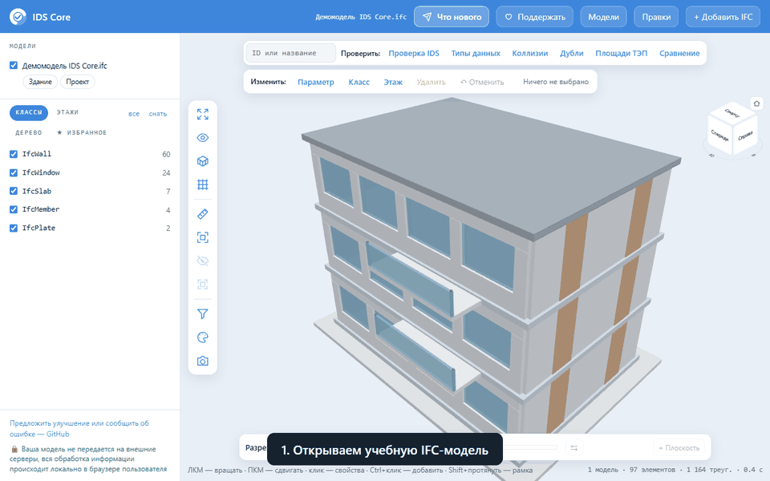

# Новости IDS Core

## 8 ноября 2026 — больше удобства в просмотрщике IFC

На сайте доступны новые инструменты для работы с моделью:

- **Дерево IFC:** раскрывайте структуру модели и выбирайте элемент или целую ветку.
- **Поиск по названию:** находите нужное без знания ID.
- **Избранное:** сохраняйте важные элементы и возвращайтесь к ним при открытии исходной модели.
- **Две плоскости разреза:** добавляйте вторую плоскость, чтобы видеть полосу модели.
- **Скриншоты с пометками:** стрелки, рамки и текст с выгрузкой PNG.
- **Сводка правок:** перед сохранением смотрите список изменений и скачивайте TXT или JSON. Журнал JSON можно применить к исходным IFC у коллеги.

Управление видом перенесено в вертикальную панель. Список моделей слева остаётся доступен при проверках IDS, площадей и других задачах.

[Открыть демомодель](https://idscore.online/viewer.html?demo=1) · [Начать со своим IFC](https://idscore.online/viewer.html)

## Где следить за обновлениями

[Telegram](https://t.me/ids_core) · [История версий плагина](https://idscore.online/docs/changelog.html) · [Дорожная карта](ROADMAP.md)
