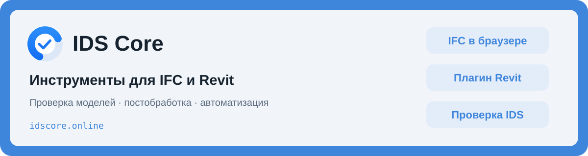
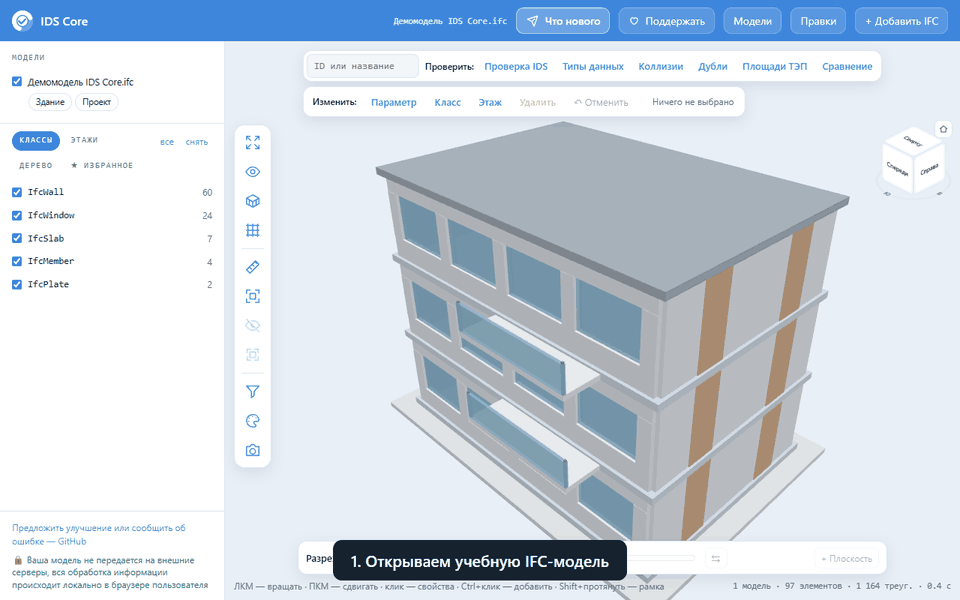

**Проверка и подготовка BIM-моделей — в браузере и Autodesk Revit.**

[Открыть IFC онлайн](https://idscore.online/viewer.html) · [Попробовать демомодель](https://idscore.online/viewer.html?demo=1) · [Плагин Revit](https://idscore.online/#revit-start)

Это публичная страница IDS Core: здесь собраны инструкции, новости и предложения пользователей.

## Как это выглядит

Демонстрация записана на учебной модели IDS Core. В просмотрщике ваша модель не передается на внешние серверы, вся обработка информации происходит локально в браузере пользователя.

## Выберите задачу

| Что нужно сделать | Где начать |
|---|---|
| Открыть IFC и посмотреть свойства | [Просмотрщик](https://idscore.online/viewer.html) |
| Проверить параметры по IDS | [Инструкция проверки](https://idscore.online/proverka-ifc-po-ids.html) |
| Найти расхождения площадей ТЭП с XML | [Площади ТЭП](https://idscore.online/proverka-ploshchadej-tep.html) |
| Сравнить две версии модели | [Сравнение IFC](https://idscore.online/sravnenie-ifc.html) |
| Найти и удалить дубли | [Работа с дублями](https://idscore.online/dubli-ifc.html) |
| Проверить коллизии и разобрать отчёт | [Коллизии](https://idscore.online/kollizii-ifc-online.html) |
| Изменить уровни | [Этажи IFC](https://idscore.online/etazhi-ifc.html) |
| Передать правки коллеге | [Журнал JSON](https://idscore.online/pravki-ifc-fajlom.html) |
| Установить плагин Revit | [Установка и первый запуск](https://idscore.online/docs/install.html) |

Плагин помогает проверять модели по IDS, заполнять параметры и коды МССК, собирать ТЭП и готовить экспорт IFC. Проверка по IDS в плагине бесплатна; условия остальных инструментов — [на сайте](https://idscore.online/#price).

## Новости и планы

- **[Что нового в просмотрщике](NEWS.md)** — последние опубликованные возможности.
- **[Дорожная карта](ROADMAP.md)** — что уже доступно и какие задачи обсуждаем.
- [История версий плагина](https://idscore.online/docs/changelog.html).
- [Обновления и примеры в Telegram](https://t.me/ids_core).

## Обратная связь

**[Сообщить об ошибке](https://github.com/1skyrill1/ids-core-community/issues/new?template=bug_report.yml)** · **[Предложить функцию](https://github.com/1skyrill1/ids-core-community/issues/new?template=feature_request.yml)**

Опишите задачу, ожидаемый результат и шаги воспроизведения. Обращения и вложения здесь публичны: для примера используйте учебную модель или фрагмент, который разрешено публиковать. Если вопрос касается конкретного объекта, [напишите команде лично](https://t.me/ifc_expert).

[С чего начать](docs/quick-start.md) · [Как участвовать](CONTRIBUTING.md) · [Подготовка ЦИМ АГР, НПМ и ВПМ](https://idscore.online/uslugi.html) · [Сайт IDS Core](https://idscore.online/)
